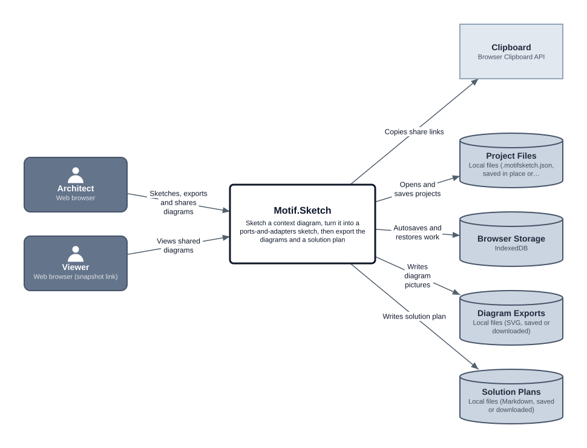
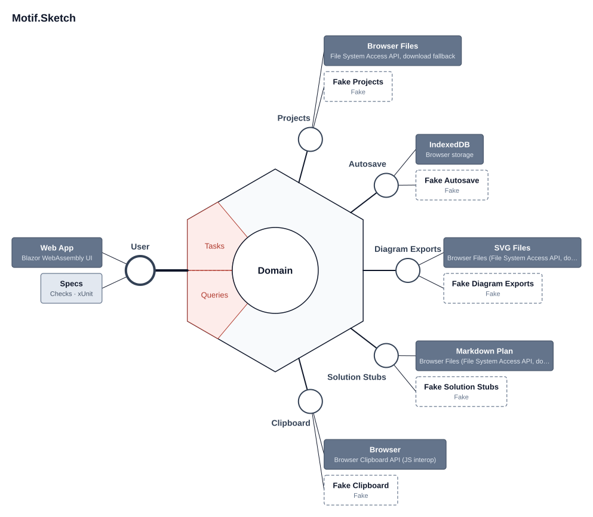

# Motif Sketch

The first tool in the **[Motif.NET](https://github.com/motif-dotnet)** suite. You sketch a system context diagram, turn it into a ports-and-adapters sketch, and export both as SVG pictures, plus a Markdown solution plan a coding agent can build stubs from. It's a Blazor WebAssembly app for GitHub Pages: no server and no accounts. Your work stays in your own files and browser.

**Try it: [motif-dotnet.github.io/Motif.Sketch](https://motif-dotnet.github.io/Motif.Sketch/)**. File → Open example shows Motif Sketch's own design.

It combines and replaces two desktop tools: [Context Sketch](https://github.com/johnrpage/context-tool) and [HexaSketch](https://github.com/johnrpage/HexaSketch).

## Design

### Context diagram



### Ports and adapters



These pictures are Motif Sketch's own exports of its design, [motif/sketch.motifsketch.json](motif/sketch.motifsketch.json), which is also the bundled example. The [motif/](motif/) folder holds the design, the [solution plan](motif/plan.md) and the [glossary](motif/glossary.md).

## Status

**Trial.** Built and in use on Motif's own repos, still changing. All of [docs/build-plan.md](docs/build-plan.md) is in: both views, files and autosave, exports and the plan, snapshot links and Viewer mode, the example, and the v2 look with its dark twin. The answers to SPEC §10 are decisions 40–49.

### Still to do

1. **Run [docs/manual-checks.md](docs/manual-checks.md)** on the live site in Chrome or Edge and in Firefox, then tick off SPEC §8's acceptance checklist. The build was checked in an embedded Chromium only. These haven't been tried yet:
   - the File System Access save and open dialogs, save-in-place after a reload, and real SVG and plan files on disk
   - Firefox's upload and download fallback
   - touch: dragging, pinch-to-zoom and tap-and-hold
   - phone widths (read-only)
   - copying to the clipboard (the embedded browser refused it; the manual-copy fallback worked)
2. **Answer the open questions** at the end of [decisions.md](decisions.md#still-open).

Later ideas (not v1) are listed at the end of [decisions.md](decisions.md#later-not-v1).

## Build and run

You need the .NET 10 SDK.

```
dotnet run --project Motif.Sketch.App      # http://localhost:5173
dotnet test                                 # the specs: the core through the User port, with fakes
dotnet publish Motif.Sketch.App -c Release  # static files in bin/Release/net10.0/publish/wwwroot
```

Pushing to `main` runs `.github/workflows/pages.yml`: it runs the specs, publishes, sets `<base href>` for the `/Motif.Sketch/` sub-path, adds `.nojekyll`, and deploys to GitHub Pages.

The layout is the one Motif Sketch exports for itself ([motif/plan.md](motif/plan.md), which the specs check against the sketch):

| Folder | What's there |
|---|---|
| `Motif.Sketch.App/` | The Web App: the Blazor UI and the composition root |
| `Motif.Sketch/Motif.Sketch.Domain/` | The project and its rules, including how the sketch follows the context diagram |
| `Motif.Sketch/Motif.Sketch.UseCases/` | The ports, `MotifSketchApplication`, both layouts, the scenes and SVG writer, the plan, the file format, snapshot links and the example |
| `Adapters/` | One project per driven port, each with its small JS module |
| `Checks/` | `Motif.Sketch.Fakes` and `Motif.Sketch.Specs` |

## Files

| File | What it is |
|---|---|
| [SPEC.md](SPEC.md) | The requirements: architecture, file format, behaviour, quality bar, acceptance criteria |
| [docs/manual-checks.md](docs/manual-checks.md) | The browser checks to run before a release |
| [decisions.md](decisions.md) | Every design decision so far and why, plus ideas for later |
| [motif/](motif/README.md) | Motif Sketch's own design, solution plan, diagrams and glossary |
| [AGENTS.md](AGENTS.md) | Where coding agents start |

## Contributing

Bug reports, suggestions and pull requests are welcome; [CONTRIBUTING.md](https://github.com/motif-dotnet/.github/blob/main/CONTRIBUTING.md) says how. Issues labelled [good first issue](https://github.com/motif-dotnet/Motif.Sketch/labels/good%20first%20issue) are a gentle way in. For ideas and questions, start a thread in [Discussions](https://github.com/motif-dotnet/.github/discussions).

## License

MIT, see [LICENSE](LICENSE).
