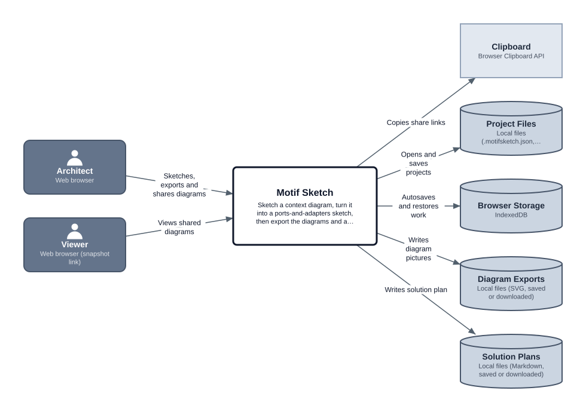
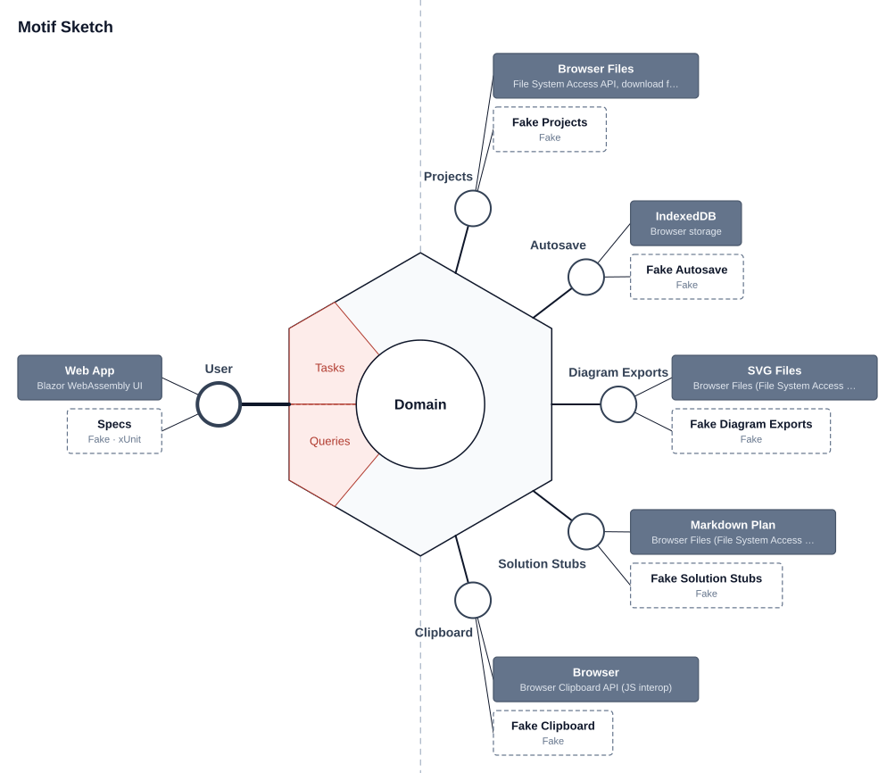

# Motif Sketch

The first tool in the **Motif** suite. You sketch a system context diagram, turn it into a ports-and-adapters sketch, and export both as SVG pictures, plus a Markdown solution plan a coding agent can build stubs from. It's a Blazor WebAssembly app for GitHub Pages: no server and no accounts. Your work stays in your own files and browser.

It combines and replaces two desktop tools: [Context Sketch](https://github.com/johnrpage/context-tool) and [HexaSketch](https://github.com/johnrpage/HexaSketch).

## Design

### Context diagram

### Ports and adapters

These pictures are rendered from the two diagram files below, by Context Sketch's and HexaSketch's own SVG exporters.

## Status

**Designing, not built yet.** The context diagram, the ports-and-adapters sketch, the spec and the look-and-feel pass are done.

### Next steps

1. ~~**Look-and-feel design pass**~~ (SPEC §9): done. See decisions 26–39 and the mockups in [docs/mockups](docs/mockups).
2. **Plan the build** from SPEC.md, resolving the planner decisions in §10.
3. **Build**, deploying to GitHub Pages from the first phase.
4. Once `.motifsketch.json` exists, make the bundled example project from this folder's two diagram files.

## Files

| File | What it is |
|---|---|
| [SPEC.md](SPEC.md) | The requirements: architecture, file format, behaviour, quality bar, acceptance criteria |
| [decisions.md](decisions.md) | Every design decision so far and why, plus ideas for later |
| [Motif Sketch - Context Diagram.contextsketch.json](<Motif Sketch - Context Diagram.contextsketch.json>) | Motif Sketch's context diagram (open it in Context Sketch) |
| [Motif Sketch.hexasketch.json](<Motif Sketch.hexasketch.json>) | Motif Sketch's ports-and-adapters sketch (open it in HexaSketch) |

The sketch is drawn with HexaSketch, which can't yet express two of Motif Sketch's ideas:
- **Merged sources:** the Viewer shows as "Not placed" even though the Web App serves it.
- **The Checks kind:** Specs shows as a Fake.

The adapter descriptions say so.

## License

MIT, see [LICENSE](LICENSE).
